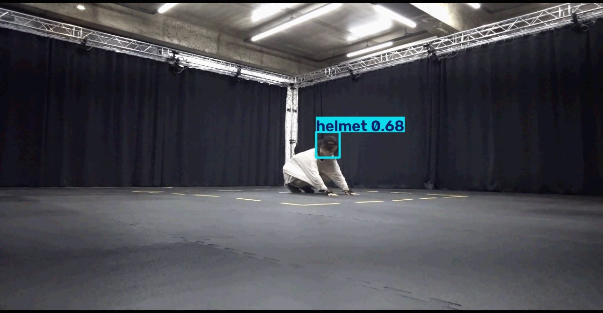

# Visual_intelligence_Hardhat

YOLOv8로 CCTV 영상에서 사람과 안전모를 인식하는 분석 서버

<br/>



<br/><br/>

## Object

<br/>

- 건설 현장 CCTV 영상에서 사람과 안전모 착용 여부를 1초 단위로 인식하는 프로그램입니다.

- 안전지대에 사람이 들어오면 헬멧을 썼는지 검출해서 알려주는 것이 목표입니다.

- 실제 화면에 보여주는 건 프론트엔드의 역할이라, 이 프로젝트는 영상을 받아서 분석하고 결과를 넘겨주는 백엔드 부분을 만들었습니다.

- 영상을 모으는 클라이언트와 분석하는 서버를 나눠서, 클라이언트가 1초마다 프레임을 보내면 서버가 YOLOv8로 검출한 결과를 JSON으로 돌려주는 구조입니다.

<br/><br/>

## Content

<br/>

1. Module 소개

2. 진행 과정

3. Result

4. 실행 방법

5. Version

6. Feedback

<br/><br/>

## 1. Module 소개

<br/>

- `predict_api.py` : 분석 서버를 띄우는 메인 모듈입니다. (Flask)

  ① `/predict` 로 프레임이 들어오면 `data/raw/` 에 저장하고 YOLOv8로 검출합니다.

  ② `save_txt=T` 로 요청하면 검출 결과(클래스, 신뢰도, 박스 좌표)를 JSON으로, 아니면 박스를 그린 이미지를 돌려줍니다.

  ③ 신뢰도 기준, IoU, 이미지 크기, GPU 사용 여부 같은 옵션은 실행할 때 인자로 바꿀 수 있습니다.

- `my_client.py` : 영상을 프레임 단위로 읽어서 1초마다 서버에 분석을 요청하는 클라이언트입니다.

- `general.py` : GET / POST 요청에서 분석할 대상과 결과 형식을 꺼내는 함수입니다.

- `send_mod.py` : 관제 화면으로 보낼 메타정보(채널, 요청 ID, 시간)를 만들고 이미지를 Base64로 바꾸는 함수입니다.

- `watcher.py` : 결과 폴더(`runs/detect`)에 파일이 쌓이면 자동으로 지워주는 모듈입니다. (watchdog)

- `hardhat.pt` : 안전모 검출용 YOLOv8 가중치 (클래스 : head, helmet, person)

<br/><br/>

## 2. 진행 과정

<br/>

### ① 영상 수집 → 분석 요청

<br/>

클라이언트가 OpenCV로 영상을 읽고, 프레임을 이미지로 저장한 뒤 1초마다 서버로 보냅니다.

<br/>

### ② 객체 검출

<br/>

서버는 받은 프레임으로 사람, 헬멧, 머리(헬멧 안 쓴 머리)를 검출합니다. 검출 결과가 없는 프레임은 예외 처리하고 다음 프레임으로 넘어갑니다.

<br/>

### ③ 결과 전달

<br/>

검출된 객체의 클래스, 신뢰도, 박스 좌표를 JSON으로 정리합니다.

관제 화면에 이미지를 같이 보내려고 결과를 Base64로 인코딩해서 채널 ID, 요청 시간과 묶어 보내는 로직도 만들었습니다. (지금 코드에서는 주석 처리)

<br/>

### ④ 결과 파일 정리

<br/>

1초마다 분석하다 보니 `runs/detect` 에 결과 폴더가 계속 생겨서, `watcher.py` 로 새 파일이 생기면 바로 지우도록 했습니다.

<br/><br/>

## 3. Result

<br/>


<br/>

위 테스트 영상(`fallen.mp4`)을 `hardhat.pt` 로 돌린 결과가 맨 위 이미지입니다.

- 사람이 앉아 있는 장면에서 머리 부분을 helmet 으로 잡았는데(신뢰도 0.68), 실제로는 안전모가 아니라 모자였습니다.

- 사람이 바닥에 누워 있는 장면에서는 person 이 잡히지 않았습니다.

- 모자를 안전모로 착각하는 경우와 쓰러진 자세를 못 잡는 경우가 있어서, 이런 데이터를 학습에 더 넣어야 실제 현장에서 쓸 수 있을 것 같습니다.

<br/><br/>

## 4. 실행 방법

<br/>

```bash
# 1. 분석 서버 실행 (http://127.0.0.1:5000)
python predict_api.py --weights hardhat.pt

# 2. 다른 터미널에서 클라이언트 실행
python my_client.py

# 결과 이미지를 서버 쪽 화면에서 바로 보고 싶을 때
python predict_api.py --weights hardhat.pt --show
```

<br/><br/>

## 5. Version

<br/>

- python 3.10
- Flask 3.0.0
- numpy 1.26.4
- pandas 2.2.2
- ultralytics 8.2.0
- opencv-python, requests, watchdog

<br/><br/>

## 6. Feedback

<br/>

- Base64는 문자열이라 원본 이미지보다 용량이 커집니다. 실제로 쓴다면 위험 상황이 검출된 프레임만 보내는 게 맞을 것 같습니다.

- 지금은 첫 번째로 검출된 객체만 결과로 정리해서, 화면에 작업자가 여러 명이면 모두 판단하도록 바꿔야 합니다.

- `watcher.py` 의 감시 경로가 제 PC 기준 절대경로라서 환경에 맞게 바꿔야 합니다.
